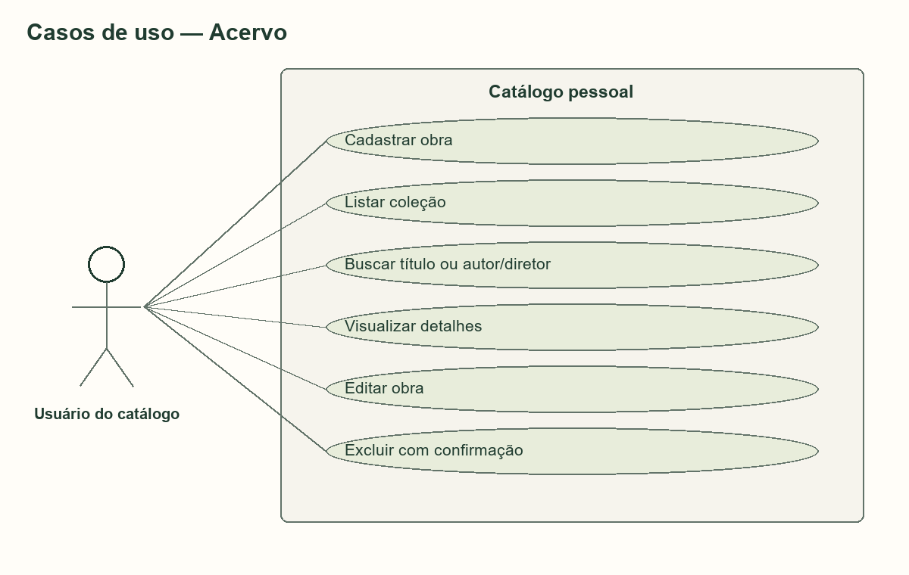
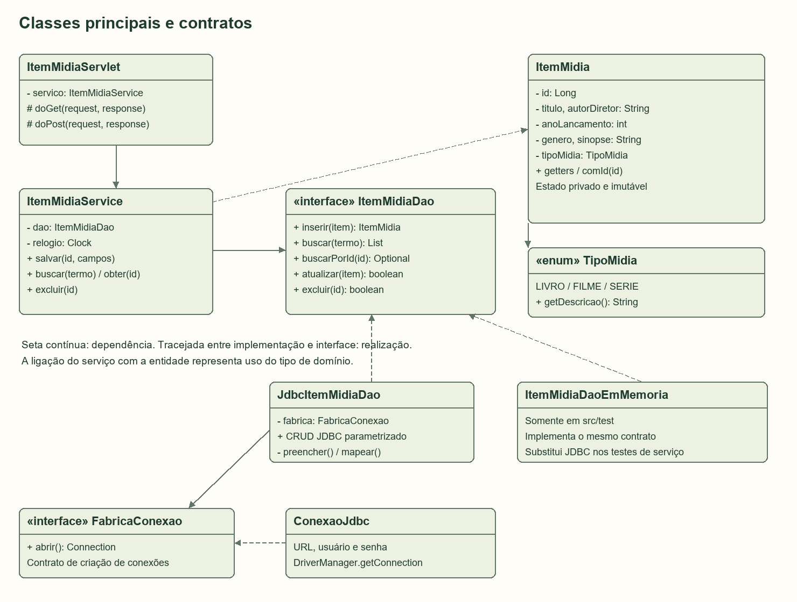
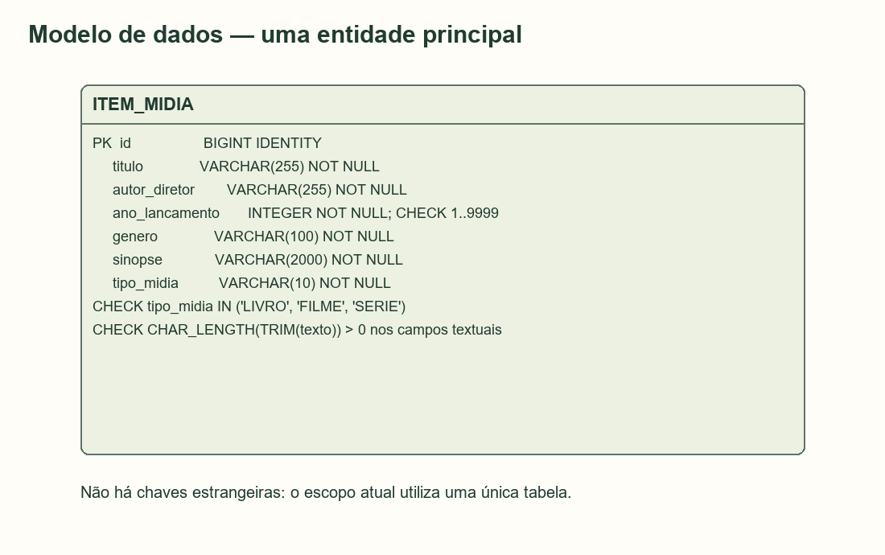
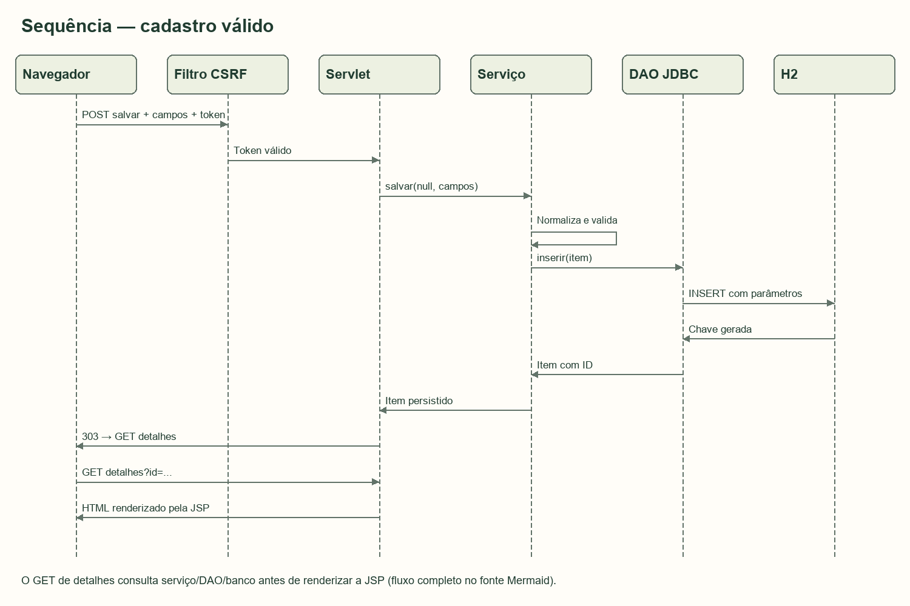
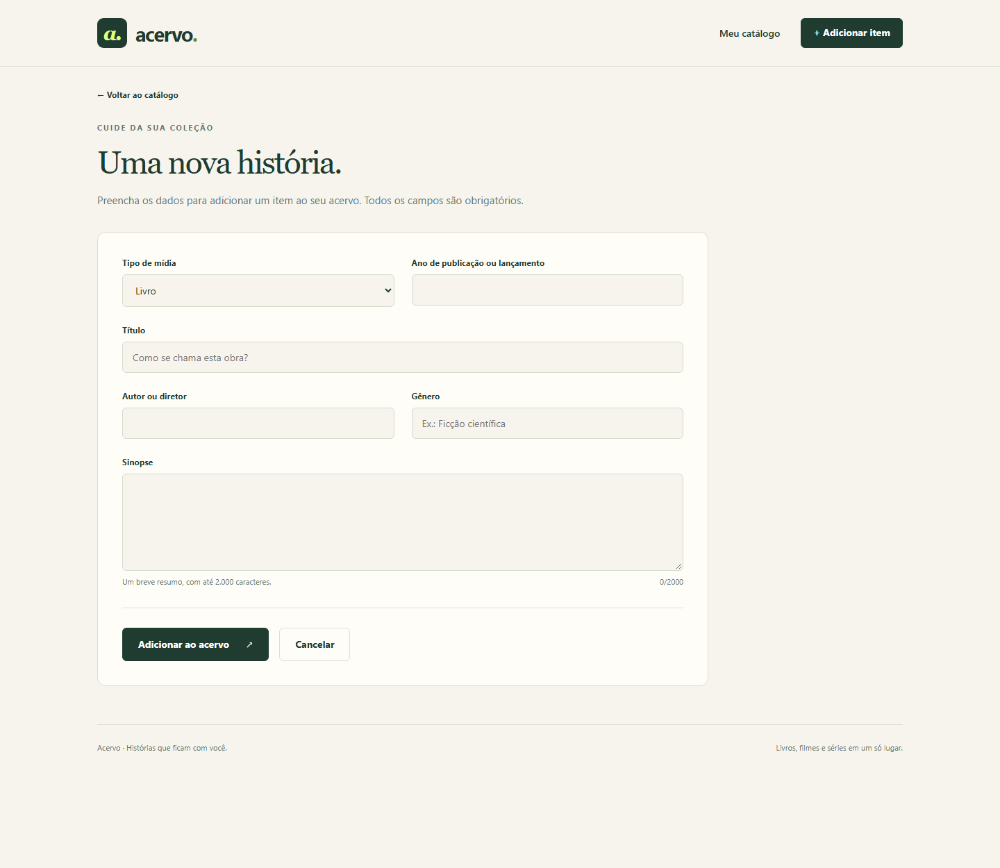
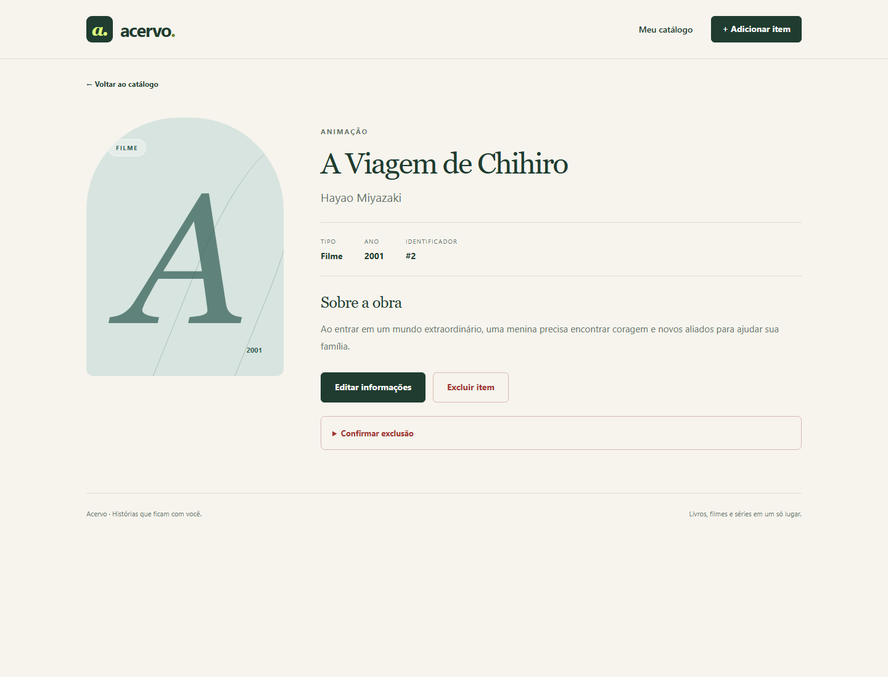
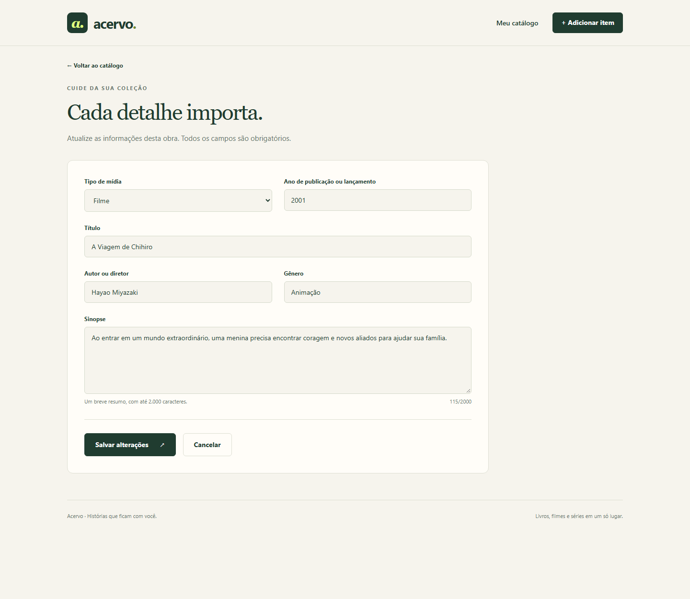

# Projeto de intervenção — Situação-Problema 3

# A Situação-Problema escolhida:

Refatoração e Orientação a Objetos. No cenário apresentado, um estudante implementou o cadastro, a listagem, a consulta de detalhes, a edição, a exclusão e a busca de um Catálogo Simples de Livros/Filmes diretamente em uma Servlet. Essa concentração de responsabilidades produziu um código extenso, difícil de compreender e manter, com repetição de operações de acesso ao banco de dados. A intervenção consiste em reorganizar o catálogo utilizando orientação a objetos e separação de responsabilidades, preservando as funcionalidades exigidas.

O projeto recebeu o nome Acervo e contempla livros, filmes e séries. A solução foi implementada em Java, com Servlets, JSP/JSTL, JDBC e banco relacional H2. A descrição do problema está nas páginas 39–40 do PDF fornecido; as funcionalidades gerais e a documentação solicitada são apresentadas nas páginas 7–9 e 20–28.

## Objetivo:

Solucionar a dificuldade de manutenção do catálogo mediante uma arquitetura em camadas, retirando da Servlet as regras de negócio e as instruções SQL. A Servlet passa a interpretar as requisições HTTP e selecionar a resposta; a classe de serviço passa a validar e coordenar as operações; o DAO passa a executar o acesso ao banco; a entidade ItemMidia representa os dados; e as páginas JSP apresentam as informações.

Os objetivos específicos são centralizar o SQL e a conversão de registros em objetos, reduzir a duplicação, facilitar a evolução do código e permitir testes das regras de negócio sem servidor web ou banco real. A aplicação deve manter cadastro, listagem, detalhes, edição, exclusão, busca por título ou autor/diretor e armazenamento permanente dos itens.

## Revisão de Conceito:

Foram utilizados os fundamentos de Java e de Programação Orientada a Objetos estudados na disciplina: classes, objetos, atributos, construtores, encapsulamento, interfaces, polimorfismo, coleções e tratamento de exceções. A entidade ItemMidia possui atributos privados e acesso por métodos públicos, enquanto o enum TipoMidia restringe os tipos aceitos a livro, filme e série.

O padrão DAO encapsula as operações de persistência. A interface ItemMidiaDao define o contrato utilizado pelo serviço, e JdbcItemMidiaDao implementa esse contrato com JDBC. Nos testes de serviço, uma implementação em memória substitui o DAO JDBC, demonstrando polimorfismo e injeção de dependências. A herança é reconhecida como um recurso de POO, mas não foi criada uma hierarquia artificial entre mídias: como as três categorias compartilham os mesmos atributos e operações, composição, interface e enum atendem ao escopo com menor complexidade.

Também foram aplicados MVC, responsabilidade única, alta coesão, baixo acoplamento, reutilização de código, CRUD, SQL parametrizado e validação. O tratamento de recursos utiliza try-with-resources; os dados apresentados nas JSPs são escapados para reduzir o risco de XSS. A metodologia de Aprendizagem Baseada em Projetos orienta a integração entre a teoria, a implementação e a reflexão sobre os resultados.

## Metodologia:

Foi adotada uma abordagem de desenvolvimento iterativo baseada em projetos, dividida em concepção e planejamento, implementação por funcionalidades, testes e refinamento, documentação e preparação da apresentação. Inicialmente, o problema foi traduzido em requisitos e modelos. Em seguida, foram implementados o modelo de domínio, a persistência, o serviço, o controlador e as telas.

O cenário anterior foi representado por um exemplo didático de Servlet concentrando responsabilidades, pois o material não fornece o código-fonte de uma aplicação legada. A implementação entregue é uma reconstrução organizada da solução solicitada. A equivalência funcional é verificada por testes do CRUD e da busca; não se afirma uma comparação executada contra um sistema anterior inexistente.

Os testes foram distribuídos em três níveis: serviço com DAO em memória, integração JDBC com H2 e integração HTTP com Tomcat real e compilação das JSPs. Foram incluídos casos válidos, dados incorretos, itens inexistentes, entradas com aspas, tentativa de SQL Injection, escape de HTML e proteção de operações POST por token CSRF. O registro dos resultados efetivamente obtidos acompanha a entrega.

## Tempo:

O cronograma de referência para execução individual é de 24 horas: 3 horas para análise e requisitos; 3 horas para modelagem; 8 horas para implementação; 4 horas para testes e refinamento; 4 horas para documentação; e 2 horas para revisão e preparação da apresentação.

Esse total é uma estimativa de planejamento, não uma medição das horas trabalhadas pelo estudante. Antes da submissão, deve ser ajustado conforme o tempo efetivamente dedicado à leitura, execução, compreensão, adaptação e revisão do projeto.

## Procedimento e material utilizado:

1. Ler o material teórico e identificar o problema central da Situação-Problema 3: o acúmulo de responsabilidades e a repetição do acesso ao banco dentro da Servlet.
2. Definir os requisitos funcionais do catálogo, os campos de cada item e as regras de validação. Delimitar o uso pessoal e acadêmico, sem login e sem upload de arquivos.
3. Produzir os diagramas de casos de uso, classes, entidade-relacionamento e sequência de cadastro. Elaborar o esquema SQL da tabela item_midia.
4. Preparar o ambiente com JDK 17 e Maven. Utilizar um editor ou IDE de preferência e navegador web para a interação com o catálogo.
5. Implementar ItemMidia e TipoMidia para representar as obras; criar a fábrica de conexões e a inicialização não destrutiva do banco H2.
6. Definir ItemMidiaDao e implementar JdbcItemMidiaDao, utilizando PreparedStatement para CRUD e busca. Reutilizar os métodos de preenchimento de parâmetros e mapeamento de resultados.
7. Implementar ItemMidiaService para validar campos obrigatórios, limites de tamanho, tipo de mídia e ano, coordenando as operações através do contrato DAO.
8. Implementar ItemMidiaServlet para roteamento HTTP, leitura de parâmetros, delegação ao serviço e seleção de JSPs. Adotar Post/Redirect/Get após operações bem-sucedidas.
9. Construir as telas de listagem, cadastro, edição, detalhes e erro com JSP/JSTL, HTML, CSS e JavaScript. Aplicar escape de saída e confirmação de exclusão.
10. Executar testes de serviço, banco e fluxo HTTP; conferir persistência em arquivo, mensagens de erro e mecanismos de proteção. Registrar o resultado real dos testes.
11. Preparar os documentos em Word e PDF, o manual de uso, o guia detalhado do código e as capturas de tela. Revisar os arquivos de entrega e preencher a identificação acadêmica.

Os materiais utilizados são o PDF da disciplina, computador com JDK 17, Maven, Tomcat 10.1, H2, JDBC, Servlets, JSP/JSTL, JUnit 5, editor de código e navegador. Python e bibliotecas de geração de documentos foram utilizados somente na preparação dos documentos, não na execução do catálogo.

## Resultado e discussão:

O resultado é uma aplicação web funcional com os recursos exigidos e código organizado por responsabilidade. O acesso SQL está concentrado na implementação DAO, as regras estão no serviço e a Servlet contém o fluxo HTTP. Os dados são persistidos em arquivo H2 e podem ser consultados após o encerramento e a reabertura das conexões. A documentação inclui modelos, instalação, explicação dos arquivos, fluxos, segurança, testes e roteiro de apresentação.

A contribuição da POO é observável na organização em objetos com funções definidas, no encapsulamento e na dependência do serviço em relação a uma interface. O DAO reduz a repetição ao reutilizar o mapeamento dos registros, o preenchimento dos parâmetros e a abertura e o fechamento de recursos. A classe de serviço melhora a testabilidade porque suas regras podem ser executadas com um DAO em memória, sem HTTP ou JDBC.

Os testes automatizados verificam as funcionalidades e os principais cenários de falha; os números e o estado final estão registrados no relatório de verificação da entrega. Não foram medidos ganhos percentuais de produtividade ou desempenho, nem realizadas pesquisas com usuários. A melhoria de manutenção é sustentada pela separação estrutural das responsabilidades e pela possibilidade demonstrada de testar as camadas isoladamente.

As limitações incluem ausência de autenticação, paginação, histórico de alterações e tratamento de edição simultânea com controle de versão. Como continuidade, podem ser adicionados esses recursos, testes com usuários e migração para outro SGBD, mediante adaptação do esquema, do driver e das particularidades SQL. O projeto atende ao escopo acadêmico proposto e evidencia como uma refatoração orientada a objetos organiza o software sem eliminar as funcionalidades originais do enunciado.


# Relatório técnico — Acervo

Projeto de intervenção em Refatoração e Orientação a Objetos — Situação-Problema 3.

Nome: ____________________________________________________________

RGM: _____________________________________________________________

## 1. Introdução, contexto e justificativa

O Acervo é um catálogo pessoal de livros, filmes e séries desenvolvido como solução para a Situação-Problema 3 do material Projetos Computacionais: da Teoria à Prática, elaborado por Artur Marques. O enunciado, nas páginas 39–40 do PDF fornecido, descreve uma aplicação cujo CRUD e busca foram implementados diretamente em uma Servlet. O resultado é uma concentração de responsabilidades que dificulta a manutenção e duplica o acesso ao banco.

O objetivo da intervenção é preservar o comportamento funcional exigido e distribuir as responsabilidades em classes coesas. A interface web permite cadastrar, listar, consultar detalhes, editar, excluir e pesquisar obras. O armazenamento utiliza H2 em arquivo por meio de JDBC. As tecnologias centrais permanecem alinhadas ao material: Java, POO, Servlets, JSP, JDBC e um banco relacional.

Não foi fornecido um repositório legado. Por isso, o cenário inicial é representado por um exemplo didático, explicitamente identificado como tal. A entrega é uma implementação completa da arquitetura proposta, e não uma alegação de alteração de um código original que o documento não disponibiliza. A refatoração é explicada como processo aplicável ao cenário, e a preservação funcional é demonstrada por requisitos e testes da implementação resultante.

## 2. Objetivos e critérios de sucesso

O objetivo geral é melhorar a organização, reutilização e testabilidade do catálogo. A solução deve satisfazer três critérios: nenhuma instrução SQL na Servlet ou no serviço; regras de validação centralizadas no serviço; e possibilidade de testar essas regras com uma implementação DAO substituta, sem iniciar HTTP ou JDBC.

Também se exige que todas as operações mandatórias continuem disponíveis pela interface web, que os dados sejam conservados no banco em arquivo e que falhas previsíveis produzam respostas compreensíveis, sem exibir SQL, credenciais ou rastros internos na página.

### 2.1 Requisitos funcionais e rastreabilidade

| ID | Requisito | Implementação | Evidência principal |
| --- | --- | --- | --- |
| RF01 | Interface web | JSP, CSS e JavaScript | Testes HTTP e capturas de tela |
| RF02 | Cadastrar obra | POST /itens/salvar | fluxoCompletoCadastroBuscaEdicaoExclusao |
| RF03 | Listar itens | GET /itens | crudRealComChaveGerada e teste HTTP |
| RF04 | Visualizar detalhes | GET /itens/detalhes | fluxoCompletoCadastroBuscaEdicaoExclusao |
| RF05 | Editar obra | GET /itens/editar e POST /itens/salvar | atualizaMantendoIdentificador e teste HTTP |
| RF06 | Excluir obra | POST /itens/excluir | excluiItemExistente e teste HTTP |
| RF07 | Buscar título ou autor/diretor | GET /itens?q=termo | buscaPorTituloOuAutorSemDiferenciarMaiusculas |
| RF08 | Persistir em banco | JdbcItemMidiaDao e H2 | dadosSobrevivemAoFechamentoEReabertura |
| RF09 | Validar campos | ItemMidiaService | testes parametrizados de limites |
| RF10 | Apresentar falhas sem quebrar o fluxo | Exceções e JSP de erro | testes HTTP de 400, 403, 404, 422 e 503 |

### 2.2 Requisitos não funcionais e limites

| ID | Requisito | Decisão verificável |
| --- | --- | --- |
| RNF01 | Separação de responsabilidades | Pacotes model, dao, service, web e config |
| RNF02 | Reutilização | Métodos preencher, mapear, consultar e modificar no DAO |
| RNF03 | Testabilidade | Serviço depende de ItemMidiaDao e de Clock injetáveis |
| RNF04 | Segurança básica | SQL parametrizado, escape HTML, validação e CSRF |
| RNF05 | Usabilidade | Rótulos, foco visível, mensagens por campo e confirmação de exclusão |
| RNF06 | Instalação reproduzível | pom.xml com versões fixadas e inicializador PowerShell |
| RNF07 | Preservação de dados | CREATE TABLE IF NOT EXISTS e H2 em arquivo |

Não foi definido nem medido um SLA de desempenho. A listagem sem paginação e a busca com LIKE são adequadas para uma coleção acadêmica pequena. Não se afirma conformidade integral com normas de acessibilidade ou segurança; foram aplicadas práticas concretas e descritas neste relatório.

## 3. Metodologia e planejamento

A Aprendizagem Baseada em Projetos orientou a passagem do problema à solução verificável. O desenvolvimento foi organizado em iterações: requisitos e modelos; domínio e persistência; validação e controle HTTP; interface e refinamento; testes, documentação e apresentação. Cada iteração produz um resultado que pode ser inspecionado.

| Etapa | Entrega | Estimativa |
| --- | --- | --- |
| Análise | Escopo, requisitos e critérios | 3 horas |
| Modelagem | Casos de uso, classes, DER e sequência | 3 horas |
| Implementação | Catálogo completo em camadas | 8 horas |
| Testes e refinamento | Suítes e correções | 4 horas |
| Documentação | Relatório, guia e manual | 4 horas |
| Revisão e apresentação | Conferência e demonstração | 2 horas |
| Total planejado | Projeto individual | 24 horas |

As horas são uma estimativa pedagógica, não o tempo medido do estudante ou da execução automatizada. O estudante deve registrar seu próprio esforço antes da entrega.

## 4. Tecnologias e decisões

Java 17 foi escolhido como versão-base compatível com o ambiente verificado. O Tomcat 10.1 fornece o ambiente Servlet 6.0 e JSP 3.1. As páginas utilizam Jakarta Tags/JSTL para iteração e escape de saída. JDBC mantém explícitas as consultas e o gerenciamento dos recursos, favorecendo a compreensão do papel do DAO. O H2 é um SGBD relacional Java que permite executar o projeto com persistência em arquivo sem instalar um servidor de banco separado. [Documentação do Tomcat](https://tomcat.apache.org/tomcat-10.1-doc/index.html), [Jakarta Tags](https://jakarta.ee/specifications/tags/3.0/), [H2](https://h2database.com/html/features.html).

O Maven organiza dependências, compilação, testes e geração do WAR; o JUnit executa os testes de serviço, persistência e integração HTTP. As versões exatas constam de pom.xml. O inicializador local utiliza Tomcat embutido, mas a aplicação também é empacotada como WAR para Tomcat externo. [Apache Maven](https://maven.apache.org/download.cgi), [JUnit 5](https://docs.junit.org/5.12.2/release-notes/).

Não foram adicionados Spring, ORM ou uma API REST paralela, pois Servlet, JSP e JDBC tornam visível a divisão de responsabilidades estudada. A entidade única com enum evita subclasses sem comportamento distinto. A interface DAO fornece o ponto de substituição relevante ao problema.

## 5. Modelagem

### 5.1 Casos de uso

O ator é o usuário do catálogo pessoal. Ele pode cadastrar, listar, buscar, visualizar detalhes, editar e excluir obras. Editar e excluir operam sobre um identificador existente; a exclusão exige confirmação na interface. Todas as escritas passam por validação ou verificação apropriada ao tipo de operação.



Os fontes editáveis ficam em docs/diagramas. O conjunto de casos de uso delimita o escopo funcional sem introduzir login, empréstimos ou upload.

### 5.2 Classes e dependências



ItemMidia encapsula os atributos da obra. TipoMidia representa as categorias válidas. ItemMidiaService recebe a interface ItemMidiaDao pelo construtor. JdbcItemMidiaDao implementa esse contrato e recebe FabricaConexao. ConexaoJdbc implementa a fábrica com DriverManager. ItemMidiaServlet conhece o serviço, mas não abre conexões. AplicacaoListener monta o conjunto de objetos na inicialização.

O DAO em memória existe somente em src/test. Ele implementa o mesmo contrato JDBC visto pelo serviço, possibilitando testes sem infraestrutura. Essa troca é um exemplo de polimorfismo por interface. Não há dependência da camada DAO em relação à Servlet ou às JSPs.

### 5.3 Modelo de dados



| Coluna | Tipo SQL | Restrição e significado |
| --- | --- | --- |
| id | BIGINT | Chave primária gerada pelo banco |
| titulo | VARCHAR(255) | Obrigatório e não vazio |
| autor_diretor | VARCHAR(255) | Obrigatório e não vazio |
| ano_lancamento | INTEGER | Entre 1 e 9999 no banco |
| genero | VARCHAR(100) | Obrigatório e não vazio |
| sinopse | VARCHAR(2000) | Obrigatória e não vazia |
| tipo_midia | VARCHAR(10) | LIVRO, FILME ou SERIE |

O arquivo executável src/main/resources/db/schema.sql é a fonte única do esquema. Não há relacionamentos entre tabelas porque há apenas uma entidade principal. Obras diferentes podem compartilhar o mesmo título; não foi imposta uma unicidade não solicitada. O serviço aplica a regra de ano até o próximo ano do calendário, enquanto o banco mantém o limite estrutural estável de 1 a 9999.

## 6. Arquitetura e processo de refatoração

### 6.1 Situação anterior, representada didaticamente

```java
// Exemplo conceitual: não é código extraído de uma aplicação legada.
protected void doPost(HttpServletRequest req, HttpServletResponse res) {
    // 1. Lê parâmetros HTTP.
    // 2. Converte e valida os campos.
    // 3. Abre conexão e escolhe INSERT ou UPDATE.
    // 4. Preenche parâmetros, executa SQL e trata SQLException.
    // 5. Repete partes desse processo para outras operações.
    // 6. Monta a resposta ou redireciona o usuário.
}
```

A falha de organização não é o tamanho isolado de um método, mas a presença de motivos de mudança diferentes no mesmo componente. Uma alteração de SQL, uma regra de ano e uma nova navegação obrigariam a modificar a mesma Servlet. Repetir a tradução de ResultSet em objetos e a configuração das conexões multiplica os lugares sujeitos a inconsistência.

### 6.2 Transformação proposta

1. Identificar os comportamentos que precisam permanecer: CRUD e busca.
2. Extrair o estado da obra para ItemMidia e os tipos aceitos para TipoMidia.
3. Definir o contrato ItemMidiaDao, sem dependência de HTTP ou JDBC.
4. Mover SQL, parâmetros e conversão dos registros para JdbcItemMidiaDao.
5. Centralizar conexão e credenciais em ConexaoJdbc e reutilizar a fábrica.
6. Mover validação e coordenação das operações para ItemMidiaService.
7. Fazer a Servlet traduzir entradas e resultados entre HTTP e serviço.
8. Manter a apresentação nas JSPs e recursos estáticos.
9. Verificar os comportamentos por testes nas três camadas relevantes.

| Aspecto | Cenário do enunciado | Implementação entregue |
| --- | --- | --- |
| SQL | Misturado ao controlador | JdbcItemMidiaDao |
| Validação de negócio | Acoplada ao HTTP | ItemMidiaService |
| Conexões | Repetidas por operação | FabricaConexao e try-with-resources |
| Conversão de registros | Repetida em consultas | mapear(ResultSet) |
| Parâmetros de escrita | Repetidos em INSERT/UPDATE | preencher(PreparedStatement, ItemMidia) |
| Teste de regras | Exige infraestrutura acoplada | DAO em memória e Clock fixo |
| Apresentação | Potencialmente misturada ao fluxo | JSP/JSTL em WEB-INF |

Essa comparação é estrutural. Não foram calculados percentuais de redução de linhas ou de velocidade de desenvolvimento, pois não há um código legado executável nem medição comparativa.

### 6.3 POO aplicada

O encapsulamento aparece nos atributos privados e finais da entidade e nas dependências privadas das classes. A abstração aparece nos contratos de persistência e de criação de conexão. O polimorfismo permite que ItemMidiaService utilize tanto JdbcItemMidiaDao quanto o DAO em memória. A composição constrói o serviço com o DAO e o DAO com a fábrica, em vez de criar essas dependências repetidamente em cada operação.

A herança é usada naturalmente quando ItemMidiaServlet estende HttpServlet, sobrescrevendo doGet e doPost. Não foram criadas subclasses de mídia artificiais: a existência de um tipo diferente não implica, por si só, comportamento diferente. Se regras específicas surgirem, essa decisão pode ser revista com base em requisitos concretos.

## 7. Funcionalidades-chave

### 7.1 Cadastro e edição



O usuário abre GET /itens/novo. A Servlet prepara os tipos disponíveis e encaminha para formulario.jsp. O filtro cria ou reutiliza um token de sessão inserido em campo oculto. No POST /itens/salvar, o filtro confere o token; a Servlet lê os campos; o serviço normaliza e valida; e o DAO executa o INSERT. O banco gera o ID. A Servlet retorna 303 com o endereço da página de detalhes, seguindo Post/Redirect/Get.

```java
ItemMidia item = servico.salvar(identificador, campos);
// O controlador não conhece a instrução INSERT ou UPDATE.
```

Na edição, o formulário traz um ID e os valores atuais. O mesmo método salvar valida os mesmos campos e chama atualizar. Se nenhuma linha for alterada, o serviço lança NaoEncontradoException, sem criar um novo registro. Em caso de erro de validação, o controlador responde 422, reapresenta os valores enviados e inclui mensagens específicas por campo.

### 7.2 Busca

A busca recebe um termo de até 255 caracteres, remove espaços nas extremidades e pesquisa título OU autor/diretor. O DAO usa LOWER para comparação sem diferença de maiúsculas e minúsculas. Um termo vazio lista tudo. A ordenação é por título em minúsculas e ID como desempate. Acentos continuam significativos.

```sql
SELECT id, titulo, autor_diretor, ano_lancamento, genero, sinopse, tipo_midia
FROM item_midia
WHERE LOWER(titulo) LIKE ? ESCAPE '!'
   OR LOWER(autor_diretor) LIKE ? ESCAPE '!'
ORDER BY LOWER(titulo), id
```

O padrão de pesquisa é passado por setString. O código escapa !, % e _ para procurar esses caracteres literalmente. A concatenação dos sinais % com o termo produz apenas um valor de parâmetro, não uma instrução SQL. Nenhuma entrada do usuário é concatenada ao comando SQL.

### 7.3 Exclusão e tratamento de falhas

A exclusão exige POST e token válido, e sua confirmação é apresentada nos detalhes. GET /itens/excluir não apaga dados e retorna 405. IDs ausentes, negativos, não numéricos ou fora do intervalo de long retornam 400. Um ID válido inexistente retorna 404. Falhas de persistência durante as operações retornam 503 com uma mensagem amigável e registram a causa no log do servidor.

O DAO transforma SQLException em PersistenciaException. O serviço não conhece o mecanismo JDBC. O controlador define a tradução HTTP dessa falha. A responsabilidade de apresentação não é colocada no DAO.

## 8. Segurança e integridade

Todas as consultas com dados variáveis utilizam PreparedStatement. O único Statement simples executa o esquema SQL estático, empacotado no projeto, durante a inicialização. try-with-resources fecha ResultSet, Statement e Connection inclusive quando ocorre erro. Como cada escrita atual consiste em uma única instrução, utiliza-se o autocommit JDBC; operações futuras com várias escritas relacionadas exigirão transações explícitas.

Os textos apresentados usam c:out ou fn:escapeXml. Valores numéricos gerados pelo banco e constantes do enum são exibidos diretamente. O filtro define UTF-8, X-Content-Type-Options, X-Frame-Options, Referrer-Policy e Content-Security-Policy. Os arquivos JavaScript e CSS são locais; não há necessidade de scripts inline ou de bibliotecas externas no navegador.

As operações POST exigem token CSRF aleatório de 256 bits associado à sessão. O cookie da sessão é HttpOnly e a aplicação usa rastreamento por cookie. O token não é autenticação nem restringe o acesso a usuários cadastrados. O servidor local escuta em 127.0.0.1 e não expõe um console web H2. Não há upload de arquivos nem execução de SQL digitado no navegador.

A configuração padrão sem senha é destinada ao banco embutido da demonstração local. As credenciais podem ser definidas por variáveis de ambiente. Uma implantação pública exigiria autenticação, autorização, HTTPS, política de cookies adequada, limitação de requisições, monitoramento e revisão de operação. Esses recursos não são declarados como implementados.

## 9. Estratégia de testes e evidências

ItemMidiaServiceTest utiliza DAO em memória e relógio fixo para verificar regras e fronteiras. JdbcItemMidiaDaoTest usa H2 real isolado para verificar CRUD, busca, restrições e armazenamento em arquivo. CatalogoHttpIT inicia Tomcat numa porta livre e executa requisições reais com cookies; assim, compila e exercita as JSPs e as demais camadas.

Os testes de serviço e JDBC são executados pelo Surefire na fase test. Os testes HTTP são executados pelo Failsafe após a geração do WAR na fase integration-test. O comando de conferência completo é `maven.ps1 verify`. Apenas `mvn test` não executa a suíte HTTP. O teste de arquivo utiliza uma pasta temporária exclusiva, sem tocar em data/catalogo.mv.db.

O registro factual de testes, contagens, falhas e ambiente acompanha o arquivo VERIFICACAO.md. Não foram realizados ensaios de carga, auditoria de segurança externa ou validação com usuários finais. As capturas de tela registram uma execução de demonstração com dados fictícios de uso do catálogo e resumos originais.

## 10. Resultados visuais


Figura 1. Coleção demonstrativa com seis obras. A interface apresenta tipo, título, autor/diretor, ano e acesso aos detalhes. As artes são tipográficas e geradas por CSS.



Figura 2. Formulário com seleção de mídia, campos obrigatórios e contador de sinopse.



Figura 3. Informações completas, acesso à edição e confirmação de exclusão.


Figura 4. Busca por autor no catálogo demonstrativo.



Figura 5. Reaproveitamento do formulário com dados existentes e identificação do item.


Figura 6. Layout de listagem em uma viewport de celular, registrado sem alteração do conteúdo funcional.

## 11. Discussão e respostas à situação-problema

Como a POO melhora a estrutura? Ela permite representar a obra como entidade e atribuir comportamentos a classes com responsabilidades claras. O controlador não precisa saber como o banco armazena o item e o serviço não depende de HTTP. O efeito prático é localizar uma mudança no componente correspondente à sua natureza.

Qual é o papel do DAO? Ele encapsula o armazenamento e o CRUD. A implementação entregue reutiliza o mapeamento do ResultSet, o preenchimento dos parâmetros e a estrutura de consultas e modificações. O contrato torna possível substituir a implementação sem alterar a lógica de validação do serviço. A migração para outro SGBD ainda exige adaptar esquema, driver e particularidades SQL; a interface não torna bancos automaticamente intercambiáveis.

Como o serviço melhora a organização e testabilidade? Ele concentra as regras obrigatórias antes da escrita e coordena as operações. Seus testes instanciam um serviço com DAO em memória e relógio fixo, demonstrando que as regras são verificáveis sem servidor ou banco. Isso reduz o acoplamento dos testes de negócio à infraestrutura.

Os desafios técnicos incluem manter a compatibilidade de pacotes jakarta entre Servlet, JSP e Tomcat; conferir a descoberta das bibliotecas de tags; preservar os valores do formulário após falhas; tratar recursos e exceções na camada correta; e evitar regras repetidas entre cadastro e edição. Os testes de integração verificam exatamente essas fronteiras que testes isolados não alcançam.

## 12. Conclusão e trabalhos futuros

O projeto fornece um catálogo completo, uma arquitetura em camadas, testes automatizados e documentação explicativa. A solução atende à Situação-Problema 3 ao retirar persistência e regras da Servlet e ao demonstrar reutilização e substituição de dependências. A manutenção melhora pela distribuição das responsabilidades, sem atribuir um ganho quantitativo não medido.

Como evolução, propõem-se paginação, filtros de gênero, autenticação, auditoria de alterações, controle de concorrência por versão e migração planejada para um SGBD servidor. A entrega mantém um escopo compatível com o projeto acadêmico e com a compreensão detalhada pelo estudante.

## 13. Referências utilizadas

MARQUES, Artur. Projetos Computacionais: da Teoria à Prática. Material teórico da disciplina, arquivo teorico (1).pdf fornecido pelo estudante, 44 páginas. Sem data editorial identificada. Base do problema: pp. 39–40; requisitos e documentação: pp. 7–9 e 20–28.

APACHE SOFTWARE FOUNDATION. Apache Tomcat 10.1 Documentation. Disponível em: https://tomcat.apache.org/tomcat-10.1-doc/index.html. Consultado em 17 out. 2026.

APACHE SOFTWARE FOUNDATION. Apache Maven: Download and Documentation. Disponível em: https://maven.apache.org/download.cgi. Consultado em 17 out. 2026. A entrega fixa Maven 3.9.9 como ferramenta local, sem afirmar que seja a versão mais recente.

ECLIPSE FOUNDATION. Jakarta Standard Tag Library 3.0. Disponível em: https://jakarta.ee/specifications/tags/3.0/. Consultado em 17 out. 2026.

H2 DATABASE ENGINE. Features. Disponível em: https://h2database.com/html/features.html. Consultado em 17 out. 2026.

JUNIT TEAM. JUnit 5.12.2 Release Notes. Disponível em: https://docs.junit.org/5.12.2/release-notes/. Consultado em 17 out. 2026.

As obras bibliográficas mencionadas pelo material da disciplina não são apresentadas aqui como leituras diretas realizadas nesta implementação. A revisão conceitual se apoia no próprio PDF fornecido e nas documentações oficiais efetivamente consultadas.


# Guia minucioso do código — Acervo

Este guia acompanha a implementação real em src/main e src/test. Seu objetivo é permitir que o estudante compreenda a responsabilidade de cada arquivo, o motivo das principais decisões e a sequência de execução. O relatório técnico apresenta o contexto acadêmico; este documento aprofunda o funcionamento interno.

## 1. Como ler o projeto

Comece por model/ItemMidia.java, depois dao/ItemMidiaDao.java e service/ItemMidiaService.java. Em seguida leia dao/JdbcItemMidiaDao.java e config. Por último, acompanhe web/ItemMidiaServlet.java e as JSPs. Essa ordem revela primeiro o problema e as regras, depois os mecanismos HTTP e SQL.

A chamada normal percorre navegador → filtro → Servlet → serviço → DAO → JDBC → banco. O retorno percorre banco → DAO → serviço → Servlet → JSP → navegador. Nem toda requisição consulta o banco: abrir um formulário vazio apenas prepara os atributos da página.

## 2. Organização e dependências de construção

### 2.1 pom.xml

O elemento packaging define war, formato convencional de aplicação web Java. O finalName catalogo determina target/catalogo.war e a pasta explodida target/catalogo. A propriedade maven.compiler.release=17 informa a versão de linguagem e APIs Java que o compilador pode utilizar; o texto-fonte é UTF-8.

As dependências Servlet, Tomcat, JSTL, H2 e JUnit correspondem a funções distintas. Servlet fornece o contrato HTTP; Tomcat executa e compila as páginas; JSTL oferece tags de apresentação; H2 implementa o banco; JUnit executa os testes. A API Servlet tem escopo provided, pois o contêiner já a disponibiliza. JUnit tem escopo test e não acompanha a aplicação.

O Compiler compila o código. Surefire encontra classes *Test. War empacota a aplicação e exclui tomcat-embed e ecj, necessários somente ao inicializador embutido. Dependency copia as dependências de execução para target/dependency. Failsafe encontra *IT e valida os testes HTTP após a preparação da aplicação web. Dessa forma, a suíte HTTP pode usar JSPs, classes e bibliotecas já reunidas em target/catalogo.

### 2.2 maven.ps1

O script usa a pasta do próprio projeto como diretório de trabalho. Procura mvn.cmd no PATH e, se não existir, baixa a distribuição 3.9.9 para .tools. Compara o SHA-512 com o valor publicado no repositório antes de extrair e executar. A primeira execução necessita de conexão à internet. O repositório Maven local é configurado em .m2, evitando depender de alterações na configuração global da máquina.

Os argumentos recebidos são repassados ao Maven. O código de saída é propagado para que iniciar.ps1 interrompa o processo se a compilação falhar. O finally restaura o diretório do terminal. A opção ExecutionPolicy Bypass usada nos exemplos vale para o processo iniciado, sem instruir uma mudança permanente da política do computador.

### 2.3 iniciar.ps1

Verifica a existência do Java, executa package e monta o classpath com target/classes e target/dependency/*. O parâmetro -SemCompilar permite reutilizar uma compilação existente. O diretório de trabalho é relevante porque a URL padrão H2 e o caminho do webapp são relativos a ele. O servidor roda no mesmo terminal e pode ser encerrado com Ctrl+C.

## 3. Entidade e enum

### 3.1 ItemMidia.java

A classe representa uma obra. O ID é Long porque um item novo ainda não tem identificador: null representa o estado anterior à inserção. Título, autor/diretor, gênero e sinopse são String; ano é int; tipo é TipoMidia.

Todos os atributos são private final. O modificador private impede acesso direto e final impede troca da referência ou do valor após a construção. Isso não significa que final tornaria qualquer objeto profundamente imutável; aqui, os próprios tipos usados são imutáveis ou primitivos. O objeto pode ser compartilhado com segurança sem receber mutações de um setter.

O construtor inicializa o estado e impede referências nulas nos textos e no tipo com Objects.requireNonNull. Ele não substitui a validação de negócio: tamanhos, valores vazios e calendário são responsabilidade do serviço. O DAO reconstrói a entidade a partir dos registros já armazenados.

comId cria outra entidade com os mesmos dados e o ID recebido. O INSERT pode retornar a versão persistida sem alterar a instância fornecida pelo chamador. Os getters servem ao serviço, DAO e Expression Language das JSPs: item.titulo resolve getTitulo, e item.tipoMidia.descricao resolve getTipoMidia().getDescricao().

### 3.2 TipoMidia.java

LIVRO, FILME e SERIE são identificadores estáveis, gravados no banco com name(). Cada constante guarda uma descrição amigável: Livro, Filme e Série. O construtor do enum associa as duas representações, e getDescricao oferece o texto para a interface. Essa separação evita depender de acentos no valor persistido ou de valores livres para as categorias.

Não há subclasses Livro e Filme porque o comportamento atual é igual. A POO não exige criar herança em toda diferença de rótulo. Se um futuro requisito trouxer comportamentos próprios, o modelo poderá evoluir com base nessa necessidade.

## 4. Exceções e divisão das falhas

### 4.1 ValidacaoException.java

Recebe um mapa de chave de campo para mensagem. A ordem é conservada por LinkedHashMap e o conteúdo é exposto por uma visão não modificável de uma cópia. Assim, o consumidor não altera o conjunto de erros depois da emissão. O controlador coloca esse mapa em request.erros e a JSP apresenta cada mensagem ao lado do campo correspondente.

### 4.2 NaoEncontradoException.java

Representa o caso de uma obra não existir. O serviço a utiliza quando uma consulta retorna Optional.empty ou uma escrita afeta zero linhas. O controlador traduz para 404. Essa classe mantém o significado de negócio separado de SQLException e de códigos HTTP.

### 4.3 PersistenciaException.java

Encapsula falhas de armazenamento e preserva a causa com super(mensagem, causa). Essa causa é importante para depuração no log. O controlador apresenta uma mensagem pública genérica, sem reutilizar o texto detalhado da exceção SQL. O serviço e o controlador não precisam declarar SQLException em suas assinaturas.

## 5. Configuração e inicialização do banco

### 5.1 FabricaConexao.java

É uma interface funcional com abrir(), que retorna Connection e pode lançar SQLException. O DAO conhece esse contrato, mas não decide a URL, as credenciais nem o ambiente de execução. Nos testes, uma expressão lambda pode devolver uma conexão de teste ou lançar uma falha simulada.

### 5.2 ConexaoJdbc.java

O construtor armazena URL, usuário e senha e verifica a presença do driver H2. doAmbiente lê CATALOGO_DB_URL, CATALOGO_DB_USER e CATALOGO_DB_PASSWORD, utilizando os padrões documentados quando as variáveis não existem. A senha vazia pode ser uma escolha explícita para o banco embutido da demonstração.

abrir chama DriverManager.getConnection. Cada operação DAO recebe uma nova conexão e a fecha ao terminar. Não existe uma Connection global compartilhada entre requisições. Essa decisão simplifica o ciclo de vida e evita compartilhar um objeto de conexão simultaneamente. Um pool de conexões poderia ser introduzido atrás da interface em outro contexto.

### 5.3 BancoDados.java

inicializar lê /db/schema.sql do classpath com UTF-8. A ausência do recurso é uma falha de empacotamento e impede uma inicialização silenciosa e incompleta. O script é dividido por ponto e vírgula e seus comandos são executados. Esse leitor é adequado ao esquema simples entregue, não é um parser SQL geral para funções ou rotinas com ponto e vírgula interno.

O Statement simples recebe somente o SQL estático do projeto. Não lê SQL de parâmetros HTTP. Os recursos de arquivo, conexão e comando são fechados por try-with-resources. Falhas de SQL ou leitura são encapsuladas como persistência. A criação usa IF NOT EXISTS e nunca apaga dados ou adiciona obras automaticamente.

### 5.4 schema.sql

GENERATED BY DEFAULT AS IDENTITY cria IDs no banco e PRIMARY KEY garante identidade única. NOT NULL impede valores ausentes. CHECK de comprimento impede textos vazios ou compostos apenas de espaços comuns. VARCHAR limita o tamanho das colunas. A restrição do tipo impede valores fora do enum.

A regra estática do banco para o ano é 1 a 9999. O serviço aplica uma regra mais específica, até o próximo ano do calendário. Essa separação evita uma migração anual do esquema. Há defesa de integridade no banco e mensagens orientadas ao usuário no serviço. A aplicação não expõe escrita direta ao banco pelo navegador.

## 6. Contrato DAO

ItemMidiaDao declara cinco operações. inserir retorna o item com ID, buscar retorna uma lista, buscarPorId retorna Optional, atualizar e excluir retornam boolean para indicar se houve uma linha afetada. Esses retornos deixam explícita a diferença entre sucesso, conjunto vazio e registro inexistente.

A interface não inclui request, response, JSP, PreparedStatement ou SQLException. O contrato fala em itens e resultados do catálogo. A implementação pode variar sem transferir detalhes JDBC ao serviço. O contrato pressupõe que a camada de serviço já normalizou o termo de busca e validou os dados da escrita.

## 7. JdbcItemMidiaDao, método a método

### 7.1 Estado e constantes

O DAO recebe FabricaConexao no construtor e a conserva em atributo final. COLUNAS concentra a projeção comum das consultas. Não usa SELECT *: a lista explícita de colunas mostra quais campos o mapeamento espera. Essa constante é interna, sem dados do usuário.

### 7.2 inserir

Monta INSERT com seis placeholders. Abre conexão e PreparedStatement configurado com RETURN_GENERATED_KEYS. preencher atribui os valores de domínio aos seis parâmetros. executeUpdate executa a escrita e getGeneratedKeys obtém o ID gerado pelo banco. Se não houver chave retornada, a operação não inventa um ID; sinaliza SQLException, encapsulada na saída do método.

ResultSet, comando e conexão têm escopos de fechamento próprios. O retorno é item.comId, conservando a entidade original. A escrita atual é uma única instrução e usa o autocommit padrão. Não existe uma sequência de várias alterações que exigiria begin/commit manual neste caso.

### 7.3 buscar

Quando o termo é vazio, executa SELECT com ORDER BY LOWER(titulo), id. Quando há termo, cria o padrão com % nas extremidades e aplica LOWER a título e autor. A condição usa OR, portanto qualquer um dos dois campos pode encontrar a obra.

O caractere ! é o escape da expressão LIKE. Primeiro ! vira !!, depois % vira !% e _ vira !_. A ordem importa: se ! fosse escapado por último, os escapes introduzidos seriam novamente alterados. O padrão é passado por setString aos dois placeholders. A parte constante do SQL pode ser concatenada com outra constante sem criar SQL Injection; o ponto essencial é não concatenar entrada do usuário ao comando.

A busca é insensível à caixa, mas não remove acentos. A ordenação é simples, não foi configurada uma collation linguística portuguesa. LIKE com % no início pode exigir varredura das linhas e não é anunciado como otimizado para grandes acervos.

### 7.4 buscarPorId

Reutiliza consultar com WHERE id = ?. O lambda configura setLong. O resultado se transforma em stream().findFirst(). Como ID é chave primária, há no máximo uma linha. Se não houver linha, o retorno é Optional.empty, e o serviço decide como essa ausência afeta o caso de uso.

### 7.5 atualizar

Executa UPDATE dos seis atributos da obra com WHERE id = ?. Reutiliza preencher para os parâmetros 1 a 6 e adiciona ID na posição 7. O boolean retornado informa se o registro existia no momento da escrita. Não depende de uma consulta prévia sujeita ao intervalo entre leitura e alteração.

### 7.6 excluir

Executa DELETE com um único parâmetro long. Não recebe um fragmento SQL ou uma lista de IDs em texto livre. Retorna false se nenhuma linha existia. A confirmação visual e a proteção do método HTTP pertencem à interface e ao filtro, não ao DAO.

### 7.7 consultar

Centraliza a estrutura de consultas: abre recursos, recebe um configurador de parâmetros, executa SELECT, percorre resultado.next, chama mapear e retorna ArrayList. O while transforma cada linha em uma entidade. Se não há linhas, a lista fica vazia. Qualquer SQLException é encapsulada com indicação da operação.

### 7.8 modificar

Centraliza a estrutura das escritas de atualização e exclusão: abre recursos, aplica os parâmetros e verifica executeUpdate() > 0. Não é usado pelo INSERT porque a inserção precisa retornar chaves geradas. Essa diferença preserva uma abstração simples, sem forçar todas as operações a caberem em uma função genérica difícil de entender.

### 7.9 preencher e mapear

preencher estabelece a relação fixa entre parâmetros 1–6 e os campos de ItemMidia. INSERT e UPDATE usam a mesma ordem. mapear realiza a transformação inversa, lendo as colunas por nome e convertendo tipo_midia por TipoMidia.valueOf. Essa centralização impede que consultas diferentes reconstruam a entidade de formas divergentes.

### 7.10 Interface privada Parametros

O método aplicar recebe PreparedStatement e admite SQLException. Assim, os lambdas de configuração podem utilizar os setters JDBC sem tratar a mesma exceção em todos os chamadores. A interface é privada porque é um detalhe interno da implementação DAO, não uma API de negócio.

## 8. ItemMidiaService, método a método

### 8.1 Construtores e relógio

O construtor simples utiliza Clock.systemDefaultZone. O construtor completo recebe DAO e Clock. Ambos os objetos são obrigatórios. Clock permite testar o limite de ano com uma data fixa, sem o teste mudar de resultado quando o calendário muda. O serviço não instancia JdbcItemMidiaDao internamente.

### 8.2 salvar

Recebe ID opcional e mapa de campos textuais. Cria um mapa de erros e usa texto para validar título, autor/diretor, gênero e sinopse. Cada valor é normalizado com strip, removendo espaços das extremidades. O ano é convertido por Integer.parseInt e comparado com 1 e Year.now(relogio)+1. Valor não numérico ou fora de int gera mensagem específica.

O tipo é convertido com TipoMidia.valueOf. Uma categoria não prevista acumula erro. Todas as validações são avaliadas antes de qualquer escrita, e o método lança uma única ValidacaoException com o conjunto. Isso permite apresentar vários erros de uma vez, em lugar de exigir um envio por campo.

Com dados válidos, constrói ItemMidia. ID nulo seleciona inserir; ID presente seleciona atualizar. Se atualizar retorna false, o serviço lança NaoEncontradoException. O método devolve a entidade persistida ou atualizada. A distinção entre cadastro e edição é compartilhada, evitando repetir as regras em dois serviços.

### 8.3 buscar

Normaliza null como termo vazio, remove espaços e limita o tamanho a 255 caracteres. O DAO recebe um termo consistente. Um termo longo gera ValidacaoException associada ao campo q. Como se trata de uma requisição GET, o controlador apresenta uma página de erro 400 em vez do formulário de obra.

### 8.4 obter e excluir

obter rejeita IDs não positivos e converte Optional.empty em NaoEncontradoException. excluir rejeita IDs não positivos e também a ausência de linha afetada. O serviço pode ser utilizado fora do HTTP sem precisar inventar um código de resposta; ele expressa o significado e deixa a tradução para a camada de controle.

### 8.5 texto e limpar

texto centraliza obrigatoriedade e tamanho máximo, recebendo chave, descrição amigável e limite. limpar garante a normalização consistente e evita NullPointerException para campos não enviados. String.length mede unidades UTF-16, o mesmo modelo básico utilizado pelos limites HTML do formulário; não é apresentado como uma contagem linguística de grafemas.

## 9. Montagem das dependências

AplicacaoListener é um ServletContextListener. Na inicialização do contexto, utiliza uma fábrica previamente configurada para testes ou cria ConexaoJdbc.doAmbiente. Inicializa a estrutura e constrói JdbcItemMidiaDao, ItemMidiaService e o atributo de contexto itemService.

Esse ponto é chamado de composição da aplicação porque reúne os objetos e suas dependências. A Servlet recupera o serviço em init. A instância do serviço é compartilhada, mas não guarda dados de formulário ou de usuário; esses dados são variáveis locais por chamada. O DAO também mantém apenas a fábrica. Os recursos JDBC são locais a cada operação.

## 10. SegurancaFilter

doFilter converte os objetos de entrada para os contratos HTTP e define UTF-8 antes da leitura de parâmetros. Depois adiciona cabeçalhos de segurança e cache. A política de conteúdo aceita recursos do próprio site, impede enquadramento e restringe a submissão de formulários à origem atual.

O filtro obtém a sessão. Dentro de synchronized(sessao), procura um token existente ou gera 32 bytes com SecureRandom. HexFormat transforma esses bytes em 64 dígitos hexadecimais. A sincronização evita inicializações concorrentes inconsistentes do token da mesma sessão.

Em POST, lê csrfToken do formulário e compara com MessageDigest.isEqual. Token ausente ou diferente produz 403 e a JSP de erro, sem executar a cadeia restante. Se for válido, chain.doFilter permite que a Servlet prossiga. Em GET não há comparação de token; o token é preparado para os formulários.

O token não substitui login, autorização, HTTPS ou política de cookies. Sua função específica é conferir que uma escrita veio de um formulário associado à sessão corrente. Os testes verificam ausência e incorreção do token.

## 11. ItemMidiaServlet

### 11.1 init e estado

init recupera o serviço do contexto. Se ele estiver ausente, a inicialização falha claramente. O único estado de aplicação da Servlet é essa referência; campos de requisição não são armazenados em atributos da Servlet, porque uma mesma instância pode atender requisições simultâneas.

### 11.2 doGet

Carrega e remove a mensagem flash da sessão, tornando-a disponível apenas para a próxima visualização. O switch decide pela rota: / lista e busca; /novo prepara cadastro; /editar carrega dados existentes; /detalhes apresenta a obra. /salvar e /excluir retornam 405 com Allow: POST. Rotas desconhecidas retornam 404.

req.setAttribute cria dados válidos durante a requisição. exibir usa forward para a JSP protegida. O navegador recebe HTML; ele não acessa diretamente WEB-INF, nem vê o código Java da página.

### 11.3 doPost

Na rota salvar, lê ID opcional e os seis campos. Chama servico.salvar. Em sucesso, grava uma mensagem flash e retorna 303 com Location para os detalhes. Na falha de validação, mantém o mapa original, associa ID e erros, prepara opções e responde 422 com a JSP de formulário.

Na rota excluir, chama servico.excluir, registra confirmação e retorna 303 para a lista. Rotas POST não reconhecidas retornam 404. As requisições chegam aqui apenas depois de o filtro conferir o token.

### 11.4 executar

Recebe uma ação cujo corpo corresponde a GET ou POST. Concentra a tradução de exceções previsíveis: item ausente para 404; número inválido para 400; validação de busca para 400; persistência para 503 e log. IOException e ServletException permanecem no contrato do contêiner, pois não são convertidas silenciosamente em sucesso.

### 11.5 id e rota

id exige o padrão [1-9][0-9]* e utiliza Long.parseLong. Isso rejeita zero, sinal, letras, ausência e overflow. rota transforma pathInfo ausente em /. A aplicação tem um único mapeamento /itens/* e não usa o parâmetro de ação para escolher uma classe arbitrária.

### 11.6 lerCampos e prepararFormulario

lerCampos aceita somente as chaves previstas. Valores ausentes viram texto vazio para que o serviço produza mensagens de obrigatoriedade. prepararFormulario transforma uma entidade em mapa de textos, ou define LIVRO como opção inicial para um cadastro. O mesmo formulario.jsp serve ao cadastro e à edição.

### 11.7 opcoes, exibir, erro e redirecionar

opcoes disponibiliza enum e ano máximo à interface. O atributo HTML max melhora a interação, mas a regra é conferida novamente no serviço. exibir monta apenas nomes de JSP constantes escolhidos pelo programa. erro define o status e a mensagem antes de encaminhar. redirecionar utiliza o contextPath para funcionar tanto na raiz local quanto em /catalogo no deploy WAR.

O código 303 orienta o navegador a fazer um GET após o POST. Ao atualizar a tela de detalhes, o navegador não repete o cadastro. Se alguém envia deliberadamente dois POSTs de cadastro, ainda pode criar duas obras; não há uma chave de idempotência no escopo entregue.

## 12. ServidorLocal e web.xml

ServidorLocal.iniciar prepara o diretório Tomcat, define a porta e o endereço 127.0.0.1, limita o corpo POST a 64 KiB e adiciona o webapp. O classloader pai permite localizar as classes e dependências do processo. O parâmetro FabricaConexao permite executar o mesmo webapp contra um banco isolado nos testes.

main lê CATALOGO_PORT, inicia target/catalogo e registra um shutdown hook para encerrar o Tomcat. O servidor fica aguardando no terminal. Nos testes, a porta 0 solicita uma porta livre ao sistema operacional, evitando fixar 8080 e colidir com outras aplicações.

web.xml registra listener, filtro e Servlet explicitamente. A ordem de inicialização disponibiliza o serviço antes de carregar a Servlet. Os mapeamentos /itens/* e /* organizam roteamento e filtro. A sessão expira em 30 minutos, o cookie é HttpOnly e o rastreamento é apenas por cookie. As páginas de erro 404 e 500 encaminham para a JSP de erro protegida. Um Tomcat externo usa esse mesmo descritor sem precisar executar ServidorLocal.main.

## 13. Páginas JSP e recursos do navegador

### 13.1 tags.jspf, cabecalho.jspf e rodape.jspf

Os fragmentos evitam repetir declarações, HTML comum, navegação e rodapé. tags.jspf declara as bibliotecas c e fn antes da primeira utilização de uma tag em cada JSP. O título da página é exibido por c:out, inclusive quando vem de um título digitado pelo usuário. Os caminhos de CSS, JavaScript e links usam contextPath.

Há link de salto para o conteúdo, navegação identificada e atributo lang=pt-BR. Cada fragmento que contém texto acentuado declara pageEncoding UTF-8 para que a leitura do arquivo incluído não gere caracteres incorretos. O rodapé fecha main, body e html. São inclusões estáticas de apresentação, sem consulta ao banco ou validação de negócio.

### 13.2 lista.jsp

c:choose diferencia coleção vazia e coleção com itens. c:forEach percorre request.itens e cria os cartões. fn:length calcula o total encontrado. A busca usa GET para que seu endereço possa ser reutilizado. O valor reapresentado no atributo de input utiliza fn:escapeXml.

Título, autor, gênero e sinopse são apresentados por c:out. O tipo usa a constante do enum na classe CSS e a descrição legível no texto. ID e ano são valores numéricos. A arte tipográfica de cada cartão deriva da primeira letra do título, escapada antes de entrar no HTML.

### 13.3 formulario.jsp

O ID determina título, texto do botão e inclusão do campo oculto de edição. O token de sessão acompanha o POST. Os campos usam required, maxlength e limites de ano para melhorar o preenchimento; o servidor não confia somente nessas validações do navegador.

Os valores dos atributos HTML são escapados por fn:escapeXml; o conteúdo de textarea é c:out. Isso inclui o formulário reapresentado após um erro, um ponto importante porque a entrada ainda não foi gravada. As mensagens por campo estão associadas por aria-describedby. O resumo de erros utiliza role=alert.

### 13.4 detalhes.jsp

Apresenta a obra inteira, metadados e sinopse preservando quebras de linha com CSS. O botão de exclusão abre um details que contém a confirmação e o formulário POST. Sem JavaScript, o usuário pode abrir o summary normalmente. Não há um link GET que apague a obra.

### 13.5 erro.jsp e index.jsp

erro.jsp apresenta uma mensagem pública ou um texto padrão, nunca o conteúdo bruto de uma exceção interna. index.jsp redireciona a raiz para /itens. Esse redirecionamento técnico pequeno é o único scriptlet; as JSPs de negócio usam EL/JSTL e não incluem SQL ou chamadas ao DAO.

### 13.6 style.css

As variáveis em :root definem a paleta. container centraliza o conteúdo. card-grid utiliza três colunas no desktop, duas em telas intermediárias e uma em telas pequenas. Os formulários e detalhes também adaptam a disposição. Estilos de foco e contraste foram previstos; ainda é necessária uma avaliação específica para afirmar conformidade formal de acessibilidade.

As capas usam cores, letras e formas CSS, evitando dependências de imagens externas. A classe art-LIVRO, art-FILME ou art-SERIE seleciona a paleta por categoria. prefers-reduced-motion reduz transições para quem solicita menos animação.

### 13.7 app.js

Atualiza o contador da sinopse no evento input, sem alterar o texto enviado. O botão de exclusão apenas abre o painel, aproxima-o da área visível e posiciona o foco na confirmação. O script utiliza textContent para atualizar texto, não innerHTML. O CRUD não depende de JavaScript para ser executado.

## 14. Fluxos completos para depuração

### 14.1 Cadastro válido

GET novo → token de sessão → formulario.jsp → POST salvar → filtro confere token → Servlet lê campos → serviço valida → DAO INSERT → H2 gera ID → DAO devolve entidade → 303 → GET detalhes → SELECT por ID → detalhes.jsp. Se algum elo falhar, inspecione a camada responsável antes de alterar o restante.

### 14.2 Cadastro inválido

POST com token válido → serviço acumula erros → nenhuma escrita DAO → ValidacaoException → Servlet define status 422 e atributos form/erros → JSP reapresenta o formulário. A validação não encerra o servidor e não perde as entradas digitadas.

### 14.3 Consulta sem resultado e falha SQL

ID existente em formato correto, mas ausente no banco → Optional.empty → NaoEncontradoException → 404. Banco inacessível → SQLException no DAO → PersistenciaException com causa → log e 503. Esses dois caminhos representam problemas diferentes e não são confundidos com uma lista vazia.

## 15. Testes e o que cada grupo comprova

ItemMidiaDaoEmMemoria guarda itens em LinkedHashMap e simula IDs. É um dublê de teste, não o armazenamento da execução normal. ItemMidiaServiceTest usa esse dublê e Clock fixo para testar normalização, erros acumulados, limites exatos e inválidos, atualização, exclusão e termo de busca. O contador de escritas demonstra que entradas inválidas não chegam à persistência.

JdbcItemMidiaDaoTest usa bancos H2 em memória com nomes UUID, além de um banco em arquivo numa pasta temporária. Verifica todos os campos após UPDATE, SQL Injection literal, busca com aspas e curingas, restrições do banco, reabertura do arquivo e inicialização que não apaga dados.

CatalogoHttpIT inicia Tomcat real, utiliza HttpClient com CookieManager, lê o token do formulário e envia POSTs codificados. Verifica CRUD completo, JSPs de cadastro e edição, preservação de valores, códigos de falha, CSRF, XSS nas três telas, busca maliciosa, cabeçalhos e indisponibilidade do banco. A falha simulada do banco ocorre depois da inicialização e é restaurada ao fim do teste.

O relatório VERIFICACAO.md é produzido a partir dos XMLs JUnit; o número de testes parametrizados considera cada combinação executada. Não se converte uma lista de testes planejados em resultados executados. Os testes HTTP verificam HTML e comportamento; as capturas de navegador permitem conferir a apresentação visual.

## 16. Documentação, evidências e empacotamento

scripts/gerar_documentos.py transforma os arquivos Markdown em Word e PDF, incorpora diagramas e telas, gera o relatório factual de testes e reúne o ZIP. As bibliotecas desse script estão listadas em scripts/requirements-docs.txt. Elas são ferramentas editoriais e não fazem parte do runtime Java.

docs/diagramas contém fontes Mermaid e desenhos SVG/PNG para leitura nos documentos. docs/telas contém capturas reais de um servidor de demonstração, cujo banco é separado da pasta data. O utilitário dados_demonstracao.py submete os formulários HTTP e recusa popular um catálogo que já possua itens.

A pasta entrega reúne os documentos, o WAR e um pacote de código com fontes e testes. Caches de Maven, ferramentas baixadas, dados pessoais, .git e diretórios temporários são excluídos. O pacote inclui target/classes, target/dependency e target/catalogo já preparados para iniciar com iniciar.ps1 -SemCompilar durante a apresentação; o código-fonte continua sendo a referência para alterações.

## 17. Como fazer alterações sem desfazer a separação

Para adicionar um campo, altere o esquema e planeje uma migração para bancos existentes; apenas IF NOT EXISTS não adiciona colunas. Depois atualize entidade, mapeamento/parâmetros DAO, validação, formulário e testes. Essa mudança atravessa camadas porque modifica o modelo de dados, mas cada responsabilidade continua localizada.

Para mudar a regra de ano, altere o serviço, o limite apresentado no formulário e os testes de fronteira. Para mudar o visual, altere JSP/CSS sem criar dependência da persistência na apresentação. Para outro armazenamento, implemente ItemMidiaDao e modifique a composição, testando a equivalência do contrato. Para várias escritas atômicas, projete uma fronteira transacional explícita antes de simplesmente chamar vários DAOs em autocommit.

Os próximos recursos devem responder a necessidades concretas. Login exige autenticação e autorização; paginação exige parâmetros de página e consultas limitadas; edição simultânea exige controle de versão. A arquitetura facilita localizar esses trabalhos, mas não os implementa automaticamente.


# Manual do usuário — Acervo

## 1. Instalar e iniciar

Instale o JDK 17 ou superior. Confirme em um terminal com `java -version` e `javac -version`. Extraia o pacote completo em uma pasta com permissão de escrita. Abra o PowerShell nessa pasta e execute:

```powershell
powershell -NoProfile -ExecutionPolicy Bypass -File .\iniciar.ps1
```

Na primeira execução, aguarde os downloads e a compilação. Quando aparecer a mensagem de disponibilidade, abra `http://localhost:8080/itens`. Mantenha o terminal em execução. Para encerrar, pressione `Ctrl+C`. Para abrir novamente sem recompilar, utilize `iniciar.ps1 -SemCompilar` depois de uma compilação bem-sucedida.

O catálogo começa vazio. Os dados ficam em `data/catalogo.mv.db`. Não é necessário instalar um servidor de banco separado. Python não é necessário para utilizar a aplicação.

## 2. Cadastrar e consultar

Clique em **Adicionar item**. Escolha Livro, Filme ou Série e preencha título, autor/diretor, ano, gênero e sinopse. Todos os campos são obrigatórios. O ano deve ser inteiro, de 1 até o próximo ano do calendário. Os limites são: título e autor/diretor, 255 caracteres; gênero, 100; sinopse, 2.000.

Clique em **Adicionar ao acervo**. A página de detalhes confirma o cadastro. Caso haja um erro de preenchimento, os dados permanecem no formulário e a mensagem indica o que corrigir.

No catálogo, clique em **Ver detalhes** ou no título. A página apresenta os dados completos da obra. As cores e letras das capas são ilustrações tipográficas, não imagens oficiais das obras.

## 3. Buscar, editar e excluir

Digite parte do título ou do autor/diretor na caixa de busca e clique em **Buscar**. A pesquisa não diferencia maiúsculas de minúsculas. Acentos são significativos. Os símbolos `%` e `_` são pesquisados literalmente. Clique em **Limpar busca** para voltar à coleção completa.

Nos detalhes de uma obra, selecione **Editar informações**, ajuste os campos e clique em **Salvar alterações**. **Cancelar** retorna ao catálogo sem salvar as mudanças do formulário.

Para excluir, clique em **Excluir item** e confirme em **Sim, excluir este item**. A exclusão é permanente. Sem JavaScript, abra **Confirmar exclusão** diretamente; o formulário continua funcionando.

## 4. Dificuldades e conservação dos dados

Se a porta estiver ocupada, encerre o servidor, execute `$env:CATALOGO_PORT = '8081'`, reinicie e abra `http://localhost:8081/itens`.

Se o formulário expirar, reabra a tela e envie novamente. Se o banco ficar indisponível, confira o terminal e as permissões da pasta. Evite abrir duas instâncias com o mesmo arquivo H2.

Para backup, encerre o servidor e copie a pasta `data` para um local de sua escolha. Para restaurar, mantenha o servidor encerrado e substitua essa pasta por seu backup. Não copie o arquivo enquanto a aplicação estiver gravando.

O servidor de demonstração atende somente no computador local. A aplicação não possui contas de usuário. Nome e RGM são preenchidos no documento acadêmico, não dentro do catálogo.


# Roteiro de apresentação — aproximadamente 7 minutos

## 1. Problema e objetivo — 1 minuto

Apresente a Situação-Problema 3, páginas 39–40: a Servlet acumula CRUD, busca, regras e SQL. Explique as consequências: alteração difícil, duplicação e testes dependentes do ambiente inteiro. Mostre o objetivo de preservar o catálogo e separar responsabilidades.

## 2. Arquitetura e POO — 1 minuto

Mostre o diagrama de classes. Siga a cadeia JSP → Servlet → serviço → interface DAO → JDBC → H2. Aponte os atributos privados de ItemMidia e o contrato ItemMidiaDao. Explique que a implementação em memória existe apenas nos testes. Não é necessário inventar subclasses de livro e filme quando o comportamento é igual.

## 3. Demonstração funcional — 2 minutos

Inicie a aplicação, cadastre uma obra, observe a confirmação e busque pelo título ou autor. Abra os detalhes, edite o gênero e confira a alteração. Exclua o item demonstrativo mediante confirmação. Use um item novo para não apagar dados relevantes.

## 4. Código e testes — 2 minutos

Abra ItemMidiaServlet e mostre a chamada `servico.salvar(...)`, sem SQL. No serviço, mostre a validação antes da escrita. No DAO, mostre `PreparedStatement` e `try-with-resources`. Execute `maven.ps1 verify` ou apresente o relatório de verificação já gerado. Explique um teste de serviço sem banco e um teste HTTP com Tomcat real.

## 5. Resultado, limites e continuidade — 1 minuto

Relacione o resultado com as três perguntas da situação-problema: organização pela POO, redução de repetição pelo DAO e testabilidade pela camada de serviço. Mencione autenticação, paginação e controle de edição simultânea como evoluções. Esclareça que o cronograma de 24 horas é estimado e deve ser substituído pelo tempo pessoal real.

## Perguntas para revisão

- Por que SQL no serviço repetiria o problema? Porque misturaria regras e detalhes do armazenamento.
- O DAO valida o ano do próximo calendário? Não; essa regra está no serviço. O banco mantém restrições estruturais básicas.
- H2 é um banco de verdade? Sim, é relacional; a execução normal grava em arquivo e os testes usam bancos isolados.
- Trocar a implementação DAO exige mudar o serviço? O contrato permanece, mas o novo DAO, o esquema e a configuração precisam ser implementados e testados.
- Como foi medido o ganho de manutenção? Não houve medição quantitativa; foram demonstradas separação de responsabilidades e substituição de dependência nos testes.


# Registro de verificação executada

Data da preparação: 17 de outubro de 2026 (America/Sao_Paulo).

Comando: `maven.ps1 verify` (Maven 3.9.9; JDK 17.0.12).

Resultado: **APROVADO**. As contagens abaixo foram lidas dos relatórios XML JUnit da execução, sem inferência a partir do código.

| Suíte | Testes | Falhas | Erros | Ignorados | Duração da suíte |
| --- | --- | --- | --- | --- | --- |
| JdbcItemMidiaDaoTest | 8 | 0 | 0 | 0 | 0.601 s |
| ItemMidiaServiceTest | 23 | 0 | 0 | 0 | 0.141 s |
| CatalogoHttpIT | 8 | 0 | 0 | 0 | 4.426 s |
| Total | 39 | 0 | 0 | 0 | — |

A duração das suítes mede a execução técnica dos testes, não as horas de trabalho do estudante e nem a duração total de downloads e compilação.

## Ambiente e alcance

Windows; Java 17; Tomcat 10.1.61; H2 2.3.232; Servlet 6.0; JSP 3.1; JUnit 5.12.2. Testes JDBC usam bancos isolados. Testes HTTP iniciam um Tomcat real em porta livre e exercitam as JSPs.

Foi verificada persistência real com fechamento e reabertura de um banco H2 em arquivo temporário. A indisponibilidade simulada do banco produz 503 e mensagem pública sem detalhes internos. O log técnico dessa simulação é esperado e não representa uma falha da suíte.

## Casos executados

### JdbcItemMidiaDaoTest

- APROVADO: aspasEInjecaoSaoDadosLiterais
- APROVADO: buscaPorTituloOuAutorSemDiferenciarMaiusculas
- APROVADO: curingasNaoAmpliamBuscaLiteral
- APROVADO: dadosSobrevivemAoFechamentoEReabertura(Path)
- APROVADO: falhaSqlPreservaCausaSemExporJdbcAoServico
- APROVADO: restricoesDoBancoProtegemIntegridade
- APROVADO: reinicializarEstruturaNaoApagaDados
- APROVADO: crudRealComChaveGerada

### ItemMidiaServiceTest

- APROVADO: acumulaTodosOsErrosSemEscreverNoDao
- APROVADO: cadastraENormalizaSemHttpOuJdbc
- APROVADO: excluiItemExistente
- APROVADO: naoTransformaEdicaoInexistenteEmCadastro
- APROVADO: consultaEExclusaoInexistentesSaoExplicitas
- APROVADO: rejeitaAnoInvalido(String)[1]
- APROVADO: rejeitaAnoInvalido(String)[2]
- APROVADO: rejeitaAnoInvalido(String)[3]
- APROVADO: rejeitaAnoInvalido(String)[4]
- APROVADO: rejeitaAnoInvalido(String)[5]
- APROVADO: rejeitaComprimentosAcimaDoLimite(String, int)[1]
- APROVADO: rejeitaComprimentosAcimaDoLimite(String, int)[2]
- APROVADO: rejeitaComprimentosAcimaDoLimite(String, int)[3]
- APROVADO: rejeitaComprimentosAcimaDoLimite(String, int)[4]
- APROVADO: aceitaLimitesDoAno(String)[1]
- APROVADO: aceitaLimitesDoAno(String)[2]
- APROVADO: aceitaComprimentosNoLimite(String, int)[1]
- APROVADO: aceitaComprimentosNoLimite(String, int)[2]
- APROVADO: aceitaComprimentosNoLimite(String, int)[3]
- APROVADO: aceitaComprimentosNoLimite(String, int)[4]
- APROVADO: atualizaMantendoIdentificador
- APROVADO: rejeitaTipoNaoPrevisto
- APROVADO: normalizaTermoEAceitaBuscaVazia

### CatalogoHttpIT

- APROVADO: buscaMaliciosaNaoRetornaTodosOsItens
- APROVADO: cabecalhosEViewsInternas
- APROVADO: rejeitaCsrfAusenteEIncorreto
- APROVADO: getNaoExcluiEIdentificadoresInvalidosNaoQuebramAplicacao
- APROVADO: escapaXssNaListaDetalhesEFormulario
- APROVADO: fluxoCompletoCadastroBuscaEdicaoExclusao
- APROVADO: erroDeValidacaoPreservaDadosNaoGravaEPermiteCorrigir
- APROVADO: indisponibilidadeDoBancoRetornaMensagemSemDetalhesInternos

## Limites da verificação

Não foram realizados testes de carga, auditoria externa, avaliação formal de acessibilidade, pesquisa com usuários ou medição quantitativa de produtividade. O deployment em um Tomcat externo não substitui a execução embutida verificada; recomenda-se conferir a configuração específica do servidor de destino.